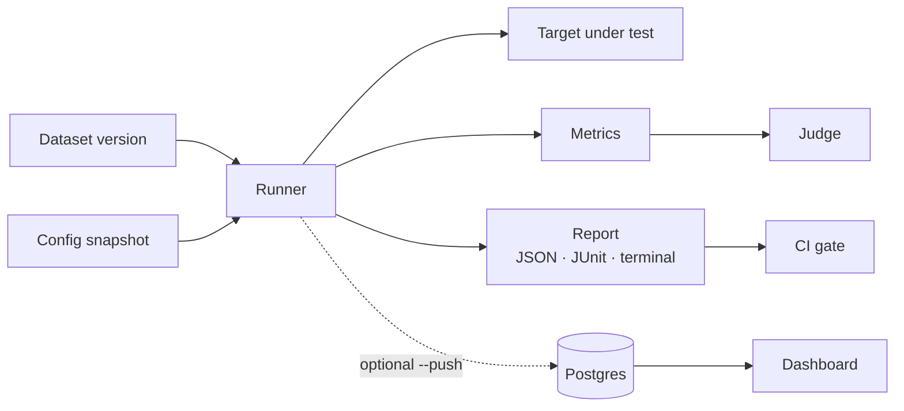

# Yardstick

> **A regression harness for LLM applications.** Turn "it feels better" into a number your CI can gate on.

<p>
  
  
  
  
</p>

**中文摘要**：Yardstick（码尺）是一个开源的 LLM 应用评测与回归平台。它把「换了模型 / 改了 prompt / 调了检索之后到底变好还是变坏」变成可复现、可对比、能在 CI 里自动拦截的一次评测运行。核心能力：数据集版本化、逐条 diff、LLM-as-judge 校准、GitHub Actions 门禁。

> ⚠️ **Pre-alpha.** Interfaces below are the contract we are building toward. Nothing is stable until `v0.1.0`.

---

## Why

Teams shipping RAG and agent products hit the same wall, and it is not "can we call the model":

1. **No regression tests.** You change one line of a prompt and have no idea whether 200 other cases still pass.
2. **Evaluation is manual.** A full pass takes 1–2 days of eyeballing, so it degrades into "let me check 10 samples".
3. **Results are not comparable.** Last week's score and this week's come from different datasets, different prompts, different judge settings — so nobody can say which one is better.

Yardstick is the missing engineering layer: **versioned datasets, per-case diffs, and a gate that fails the PR.**

---

## What it is / What it is not

| It is | It is not |
|---|---|
| An offline evaluation + regression harness | An online A/B experimentation platform |
| A CLI that runs anywhere, CI included | A hosted SaaS (self-host only, no billing) |
| A thin server for sharing runs and dashboards | A team annotation / labeling product |
| Opinionated about reproducibility | A prompt management UI (git already does this) |

---

## Architecture



Two deployment shapes, one codebase:

- **CLI only** — `yardstick run --config eval.yml`. No server, no database, no cloud. This is what CI uses.
- **CLI + server** — add `--push` to persist runs, compare across history, and view the dashboard.

See [`docs/architecture.md`](docs/architecture.md) for components, data model, and failure modes.

---

## Quick start

> Not runnable yet — this is the target interface for `v0.1.0`.

```bash
pip install yardstick

yardstick run --config eval.yml          # evaluate, print report, write runs/<id>/
yardstick compare runs/a runs/b          # per-case flip diff
yardstick push runs/<id>                 # optional: persist to server
```

A config looks roughly like this:

```yaml
dataset: examples/datasets/faq-50.jsonl
target:
  type: http
  url: http://localhost:8000/chat
metrics: [exact_match, judge]
judge:
  model: deepseek-chat
  rubric: examples/rubrics/answer_quality.md
  samples: 3
gate:
  min_score: 0.82
  max_regression: 0.02
```

---

## Core concepts

| Concept | Meaning |
|---|---|
| **Dataset version** | An immutable snapshot of cases. Two runs are only comparable if they share one. |
| **Run** | One evaluation of one target against one dataset version, with the full config snapshot attached. |
| **Judge** | An LLM scoring outputs against a rubric. Sampling and dual-model crossover tame its variance. |
| **Gate** | A threshold checked in CI. Below it, the run fails and the PR is blocked. |

---

## Metrics

Yardstick reports four layers, because "the score dropped" is useless without knowing *which* layer dropped.

| Layer | Metrics | Answers |
|---|---|---|
| Retrieval | recall@k, precision@k, MRR, nDCG@k | Did we fetch the wrong documents? |
| Generation | exact match, token F1, ROUGE-L | Is the answer right when we have the facts? |
| Semantic | judge: correctness, completeness, groundedness; faithfulness | Is the answer good when there is no gold string? |
| System | p50/p95 latency, cost per case, error rate | Is it shippable? |

Definitions, judge protocol, and calibration results live in [`docs/metrics.md`](docs/metrics.md).

---

## CI integration

Drop this into `.github/workflows/eval.yml` (details in docs):

```yaml
- uses: yardstick-dev/action@v1
  with:
    config: eval.yml
    baseline: main
```

The action runs the evaluation, posts a table on the PR, links the full report, and exits non-zero when the gate fails. A `skip-eval` label overrides it for docs-only changes.

---

## Benchmark

Self-reported, reproducible with `make bench` (once that exists). Fill these in as you measure — do not invent numbers.

| Metric | Value | Notes |
|---|---|---|
| 1,000 cases, 8-way concurrency | _TBD_ | target: < 10 min |
| Cost per 1,000 cases | _TBD_ | target: < $2 with cached judge |
| Judge agreement vs. 100 human labels | _TBD_ | Cohen's κ, target ≥ 0.7 |
| Dashboard p95 query | _TBD_ | target: < 300 ms |

---

## Design tradeoffs

Three decisions that shaped everything else. Full reasoning in `docs/adr/`.

1. **CLI first, server optional.** A tool you can run in 30 seconds beats a platform you have to deploy. It also means CI never depends on our infrastructure.
2. **Postgres only — no vector database.** We store scores and metadata, not embeddings. One dependency instead of three.
3. **A Postgres table is the job queue.** At ~1k cases per run, a broker would be a second system to operate for no throughput gain.

---

## Roadmap

- [ ] **v0.1** — CLI, 3 targets, 4 metrics, per-case flip diff, JUnit export
- [ ] **v0.2** — GitHub Action, gate rules, PR comment
- [ ] **v0.3** — server + dashboard (run list, trend, case diff)
- [ ] **v0.4** — judge calibration toolkit (`yardstick calibrate`)
- [ ] **v1.0** — plugin API for custom metrics and targets

Backlog with acceptance criteria: [`docs/issues.md`](docs/issues.md).

---

## Contributing

Issues and PRs are welcome. Start with [`CONTRIBUTING.md`](CONTRIBUTING.md) and the `good first issue` label.

## License

MIT — see [`LICENSE`](LICENSE).
